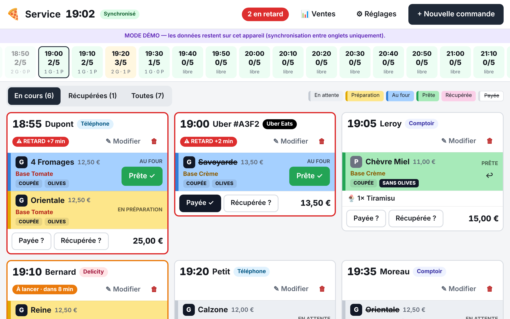
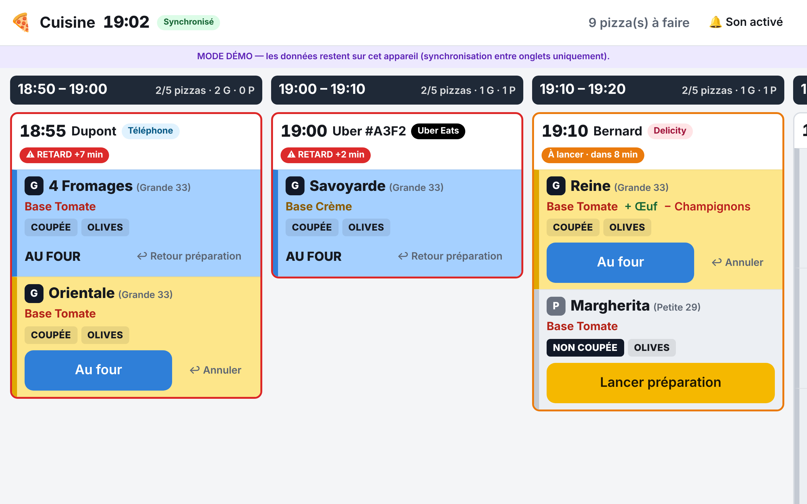

# 🍕 Kiosque à Pizzas de Frouzins

Application pour **2 tablettes synchronisées en temps réel** :

- **Écran Service** (comptoir) : prise de commande, planning par créneaux de 10 min avec quotas, suivi coloré,
  validation « Prête », paiement, retrait, alertes de retard.
- **Écran Cuisine** (pizzaiolo) : « Lancer préparation » et « Au four », avec retour arrière.

| Écran Service | Écran Cuisine |
|---|---|
|  |  |

## Documentation

- 👉 **[Guide d'installation](docs/GUIDE-INSTALLATION.md)** (Firebase, Netlify, tablettes — pas-à-pas, sans
  connaissances techniques)
- 👉 **[Mode d'emploi pour l'équipe](docs/GUIDE-UTILISATION.md)**
- 👉 **[Cahier de recette](docs/RECETTE.md)** (liste de vérifications avant la livraison)

## Fonctionnement technique (résumé)

- Application web **React + TypeScript** (Vite), installée en plein écran sur les tablettes.
- Données dans **Firebase Firestore** (temps réel, cache hors-ligne) ; connexion par **Firebase Auth**
  (un compte par tablette, le compte détermine l'écran). Règles de sécurité : [`firestore.rules`](firestore.rules).
- Hébergement **Netlify** (publication automatique à chaque modification sur GitHub, voir `netlify.toml`).
- **Mode démo** automatique tant que `src/config/firebase-config.ts` est vide : données dans le navigateur,
  synchronisées entre les onglets d'un même appareil. Pratique pour montrer l'application.

```
src/domain/       règles métier (statuts autorisés par rôle, créneaux, quotas, retards) + réglages par défaut
src/data/         accès aux données : firebaseStore (production) et demoStore (démo), même interface
src/screens/      écrans Service, Cuisine, Réglages, Connexion
tests/            tests unitaires (vitest)
e2e/              tests de bout en bout en mode démo (Playwright, 2 onglets)
e2e-firebase/     tests contre l'émulateur Firebase (synchro réelle, règles de sécurité, coupure internet)
```

## Commandes (pour un développeur)

```bash
npm install
npm run demo          # application en mode démo sur http://localhost:5173
npm run dev           # application avec la config Firebase
npm test              # tests unitaires
npm run e2e           # tests de bout en bout (mode démo)
npm run e2e:firebase  # tests avec l'émulateur Firebase (nécessite firebase-tools et Java)
npm run build         # version de production dans dist/
npm run captures      # régénère les captures d'écran de la documentation
```

## Évolutions possibles

- Commandes pour un autre jour (aujourd'hui seulement pour l'instant).
- Réception automatique des commandes Uber Eats / Delicity (saisie manuelle pour l'instant).
- Impression de tickets, statistiques de vente.
