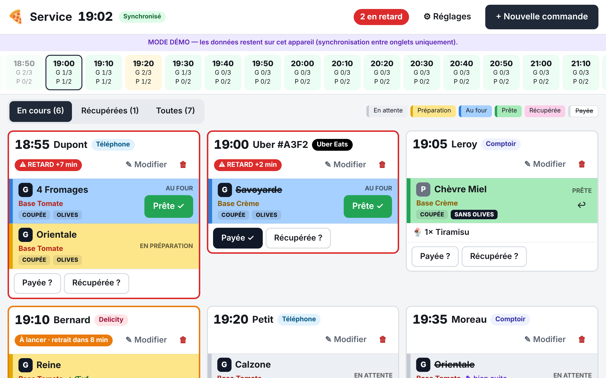
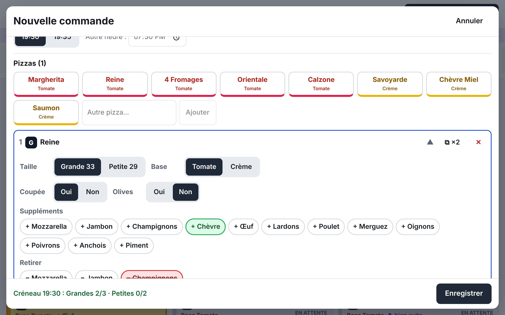
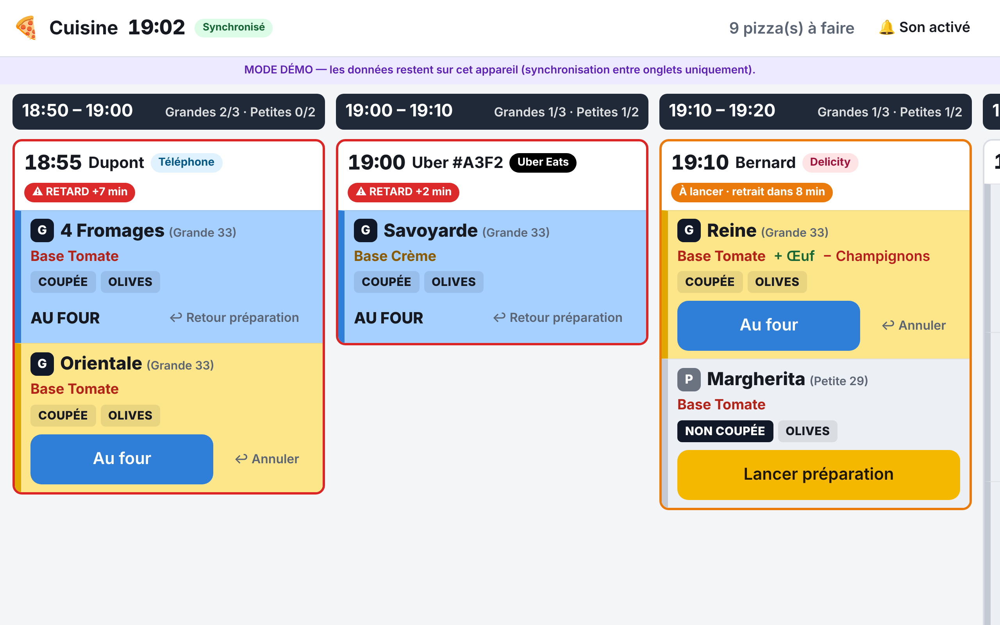

# Mode d'emploi — Kiosque à Pizzas de Frouzins

Deux tablettes, toujours synchronisées : ce qui est touché sur l'une apparaît **instantanément** sur l'autre.

| Tablette | Qui | Rôle |
|---|---|---|
| **Service** (comptoir) | Équipe de caisse | Prend les commandes, valide « Prête » à la sortie du four, paiement, retrait |
| **Cuisine** | Pizzaiolo | Seulement **« Lancer préparation »** et **« Au four »** |

## Les couleurs (écran Service)

| Ce que vous voyez | Signification |
|---|---|
| Fond **gris clair** | Pizza en attente (rien de lancé) |
| Fond **jaune** | Pizza en préparation (lancée par la cuisine) |
| Fond **bleu** | Pizza au four (indiqué par la cuisine) |
| Fond **vert** | Pizza prête (validée par le comptoir à la sortie du four) |
| Nom de pizza ~~barré~~ | Commande **payée** |
| Carte entière **rose** | Commande **récupérée** par le client |
| Cadre **rouge clignotant** + « RETARD +N min » | L'heure de retrait promise est dépassée et tout n'est pas prêt |
| Cadre **orange** + « À lancer » | Retrait dans moins de 10 min et une pizza n'est pas encore lancée |

## Écran Service

### Prendre une commande

1. **+ Nouvelle commande**.
2. **Nom du client**, puis **Origine** (Comptoir, Téléphone, Uber Eats, Delicity…).
3. **Heure de retrait** : touchez un créneau. Sous chaque heure, les places restantes (`G 2 · P 1` = encore
   2 grandes et 1 petite). Les créneaux pleins sont en rouge. Choisissez ensuite :00 ou :05, ou une heure précise.
4. **Pizzas** : touchez une pizza de la carte. Pour chacune : **Taille** (Grande 33 / Petite 29), **Base**
   (Tomate / Crème), **Coupée** oui/non, **Olives** oui/non, **suppléments** (+), **ingrédients retirés** (−),
   et un **changement** libre si besoin. « ⧉ ×2 » duplique la pizza.
5. **Autres ventes** : boissons, kiosquitos, desserts avec − / +.
6. **Déjà payée ?** puis **Enregistrer**.

Si le créneau dépasse le quota, un message rouge l'indique : choisissez un autre créneau, ou **« Forcer et
enregistrer »**.

### Suivre et terminer une commande

- **Prête ✓** : apparaît sur une pizza quand la cuisine l'a mise au four. Touchez-le quand elle sort du four.
  (« ↩ » annule en cas d'erreur.)
- **Payée ?** → la commande est payée (noms barrés). Le mode de règlement reste géré par la caisse.
- **Récupérée ?** → le client est parti avec sa commande (carte rose, elle passe dans l'onglet « Récupérées »).
- **✎ Modifier** : change l'heure, ajoute/retire des pizzas… sans perdre ce que la cuisine a déjà fait.
- **🗑** : supprime la commande (confirmation demandée).

### Le planning (bandeau du haut)

Chaque case = un créneau de 10 minutes, avec les pizzas réservées / le maximum (`G 2/3`, `P 1/2`).
Vert = libre, jaune = presque plein, orange = plein, rouge = dépassé.

**Rush ou équipe réduite ?** Touchez un créneau et ajustez son maximum avec − / +. « Revenir au défaut » annule.

### Réglages (⚙)

Carte des pizzas (avec leurs ingrédients), suppléments, boissons, kiosquitos, desserts, origines, quota par défaut
(ex. 3 grandes + 2 petites par 10 min), horaires d'ouverture, délai de pré-alerte, valeurs par défaut Coupée/Olives.
Pensez à **Enregistrer**.

## Écran Cuisine

- Une **colonne par créneau de 10 minutes**, la plus urgente à gauche.
- Chaque pizza indique en gros : taille, nom, base, suppléments (+), retraits (−), **COUPÉE / NON COUPÉE**,
  **OLIVES / SANS OLIVES**.
- Un seul gros bouton à toucher :
  1. **Lancer préparation** (la pizza devient jaune côté comptoir)
  2. **Au four** (la pizza devient bleue côté comptoir)
- Erreur de manipulation ? **↩ Retour préparation** (depuis « Au four ») ou **↩ Annuler** (depuis « préparation »).
- Plusieurs pizzas dans une commande : **Tout lancer** / **Tout au four**.
- Une nouvelle commande arrive avec un **bip** et un cadre violet « NOUVELLE ». Le son se règle en haut à droite
  (il s'active au premier toucher de l'écran).
- Quand le comptoir a validé toutes les pizzas « Prête », la commande disparaît de l'écran cuisine.

## Si internet coupe

Un **bandeau rouge « Pas d'internet »** apparaît. On peut **continuer à travailler** : les actions sont gardées sur
la tablette et partent toutes seules au retour de la connexion. En attendant, l'autre tablette ne les voit pas :
communiquez à voix haute le temps de la coupure.
