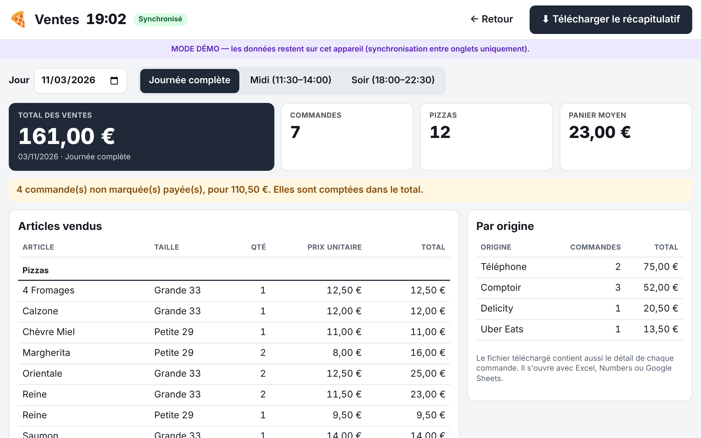

# Mode d'emploi — Kiosque à Pizzas de Frouzins

Deux tablettes, toujours synchronisées : ce qui est touché sur l'une apparaît **instantanément** sur l'autre.

| Tablette | Qui | Rôle |
|---|---|---|
| **Service** (comptoir) | Équipe de caisse | Prend les commandes, valide « Prête » à la sortie du four, paiement, retrait |
| **Cuisine** | Pizzaiolo | Seulement **« Lancer préparation »** et **« Au four »** |

## Les couleurs (écran Service)

| Ce que vous voyez | Signification |
|---|---|
| Fond **gris clair** | Pizza en attente (rien de lancé) |
| Fond **jaune** | Pizza en préparation (lancée par la cuisine) |
| Fond **bleu** | Pizza au four (indiqué par la cuisine) |
| Fond **vert** | Pizza prête (validée par le comptoir à la sortie du four) |
| Nom de pizza ~~barré~~ | Commande **payée** |
| Carte entière **rose** | Commande **récupérée** par le client |
| Cadre **rouge clignotant** + « RETARD +N min » | L'heure de retrait promise est dépassée et tout n'est pas prêt |
| Cadre **orange** + « À lancer » | Retrait dans moins de 10 min et une pizza n'est pas encore lancée |

## Écran Service

### Prendre une commande

1. **+ Nouvelle commande**.
2. **Nom du client**, puis **Origine** (Comptoir, Téléphone, Uber Eats, Delicity…).
3. **Heure de retrait** : touchez l'heure demandée par le client. Sous chaque heure, le nombre de places restantes
   (toutes tailles confondues). Vert : la commande rentre ; orange : elle ne rentre qu'en partie ; rouge : complet.
   Choisissez ensuite :00 ou :05, ou une heure précise.
4. **Pizzas** : touchez une pizza de la carte. Pour chacune : **Taille** (Grande 33 / Petite 29), **Base**
   (Tomate / Crème), **Coupée** oui/non, **Olives** oui/non, **suppléments** (+), **ingrédients retirés** (−),
   et un **changement** libre si besoin. « ⧉ ×2 » duplique la pizza.
   Le prix de chaque pizza (suppléments compris) s'affiche à droite. Pour une pizza hors carte (« Autre pizza »),
   saisissez son prix.
5. **Autres ventes** : boissons, kiosquitos, desserts avec − / + (prix affiché à côté).
6. **Déjà payée ?** puis **Enregistrer**. Le **total** de la commande est calculé automatiquement, en bas.

**Créneau trop chargé ?** Si toutes les pizzas ne rentrent pas dans le créneau demandé, celles en trop passent
**automatiquement sur le créneau suivant** (ou le prochain qui a de la place). Un message orange l'indique en bas,
avec la nouvelle heure de retrait à annoncer au client (ex. « 2 pizza(s) à 19:20, 1 pizza(s) à 19:30 → retrait à
19:30 »). Deux boutons :
- **Enregistrer (retrait 19:30)** : accepte ce planning ;
- **Forcer tout sur 19:20** : garde toutes les pizzas sur le créneau demandé, même au-delà du maximum.

### Suivre et terminer une commande

- **Prête ✓** : apparaît sur une pizza quand la cuisine l'a mise au four. Touchez-le quand elle sort du four.
  (« ↩ » annule en cas d'erreur.)
- **Payée ?** → la commande est payée (noms barrés). Le mode de règlement reste géré par la caisse.
- **Récupérée ?** → le client est parti avec sa commande (carte rose, elle passe dans l'onglet « Récupérées »).
- **Total** : en bas à droite de chaque carte.
- **« demandé 19:20 »** à côté de l'heure : des pizzas ont basculé sur un créneau suivant, l'heure en gros est
  l'heure de retrait annoncée. Les pizzas concernées portent un badge orange « créneau 19:30 ».
- **✎ Modifier** : change l'heure, ajoute/retire des pizzas… sans perdre ce que la cuisine a déjà fait.
- **🗑** : supprime la commande (confirmation demandée).

### Le planning (bandeau du haut)

Chaque case = un créneau de 10 minutes, avec les pizzas prévues / le maximum (ex. `3/5`), toutes tailles
confondues, et en dessous le détail grandes / petites. Vert = libre, jaune = presque plein, orange = plein,
rouge = dépassé (pizzas forcées).

**Rush ou équipe réduite ?** Touchez un créneau et ajustez son maximum avec − / +. « Revenir au défaut » annule.

### Réglages (⚙)

Carte des pizzas (ingrédients, **prix Grande** et **prix Petite**), suppléments, boissons, kiosquitos et desserts
(chacun **avec son prix**), origines, nombre maximum de pizzas par créneau de 10 min (ex. 5), horaires
d'ouverture, délai de pré-alerte, valeurs par défaut Coupée/Olives. Pensez à **Enregistrer**.

Un changement de prix s'applique aux nouvelles commandes ; les commandes déjà passées gardent leur prix.

### Ventes (📊) — à la fin du service

1. Bouton **📊 Ventes** en haut de l'écran Service.
2. Choisissez le **jour** (aujourd'hui par défaut) et la **période** : Journée complète, Midi ou Soir
   (d'après les horaires d'ouverture).
3. L'écran affiche le total des ventes, le nombre de commandes et de pizzas, le panier moyen, les articles vendus
   (quantité, prix unitaire, total) et la répartition par origine.
4. **⬇ Télécharger le récapitulatif** : enregistre un fichier tableur (`ventes-2026-11-10-soir.csv`) dans le dossier
   **Téléchargements** de la tablette. Il s'ouvre avec Excel, Numbers ou Google Sheets et contient en plus le
   détail de chaque commande.

Toutes les commandes de la période sont comptées, y compris celles non marquées payées (un message en indique le
nombre et le montant). Une commande supprimée (🗑) n'est pas comptée.

## Écran Cuisine

- Une **colonne par créneau de 10 minutes**, la plus urgente à gauche, avec en haut le nombre de pizzas prévues /
  le maximum.
- Si des pizzas d'une commande ont basculé sur le créneau suivant, la commande apparaît dans les deux colonnes,
  chacune avec ses pizzas, et un bandeau orange le rappelle (« Même commande : 1 pizza(s) sur 19:20 »).
- Chaque pizza indique en gros : taille, nom, base, suppléments (+), retraits (−), **COUPÉE / NON COUPÉE**,
  **OLIVES / SANS OLIVES**.
- Un seul gros bouton à toucher :
  1. **Lancer préparation** (la pizza devient jaune côté comptoir)
  2. **Au four** (la pizza devient bleue côté comptoir)
- Erreur de manipulation ? **↩ Retour préparation** (depuis « Au four ») ou **↩ Annuler** (depuis « préparation »).
- Plusieurs pizzas dans une commande : **Tout lancer** / **Tout au four**.
- Une nouvelle commande arrive avec un **bip** et un cadre violet « NOUVELLE ». Le son se règle en haut à droite
  (il s'active au premier toucher de l'écran).
- Quand le comptoir a validé toutes les pizzas « Prête », la commande disparaît de l'écran cuisine.

## Si internet coupe

Un **bandeau rouge « Pas d'internet »** apparaît. On peut **continuer à travailler** : les actions sont gardées sur
la tablette et partent toutes seules au retour de la connexion. En attendant, l'autre tablette ne les voit pas :
communiquez à voix haute le temps de la coupure.
